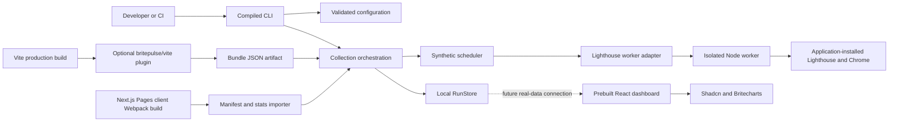
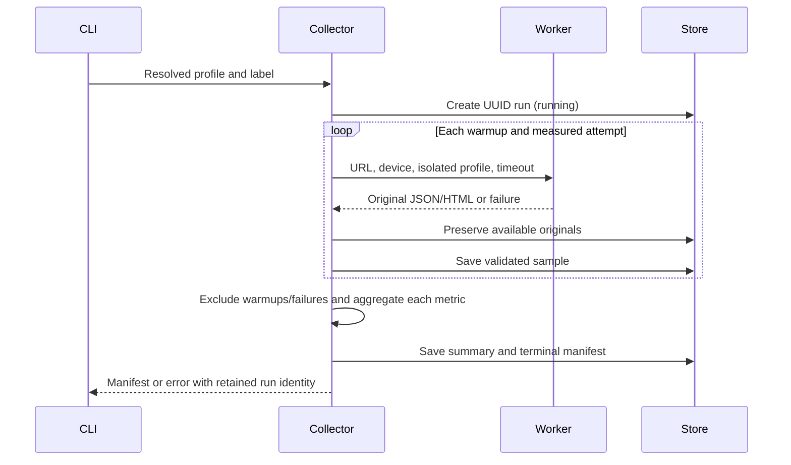
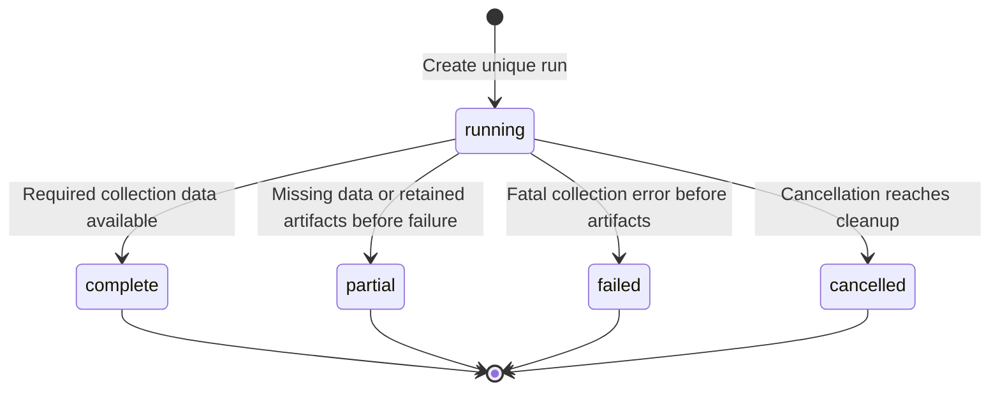

# BritePulse architecture

Explanation · [Documentation home](docs/README.md)

BritePulse is a local CLI and artifact pipeline. Collection produces immutable history; presentation consumes normalized data. Browser engines, build tools and the React dashboard have separate ownership so a help command or core API import does not start a build tool, browser or UI.

## Workspace boundaries

Solid arrows describe implemented relationships. The dashed history-to-dashboard link is planned: the dashboard currently displays labeled sample data. The Next.js importer is validated for Pages Router initial assets only; async, App Router and Turbopack attribution remain unavailable.

| Boundary                    | Owner                                                                  | Responsibility                                                                                    |
| --------------------------- | ---------------------------------------------------------------------- | ------------------------------------------------------------------------------------------------- |
| CLI and prompts             | `packages/britepulse/src/cli.ts`, `commands.ts`, `interactive.ts`      | Argument parsing, JSON output, guided setup and cancellation requests                             |
| Configuration and contracts | `config.ts`, `contracts.ts`, `validation.ts`                           | Defaults, validation, inferred types, profile fingerprints and explicit unknowns                  |
| History and processes       | `store.ts`, `process.ts`, `orchestration.ts`                           | Immutable identities, atomic visibility, temporary work and process termination                   |
| Synthetic collection        | `measure.ts`, `synthetic-scheduler.ts`, `synthetic-aggregation.ts`     | Attempt policy, sample persistence, per-metric aggregation and terminal run status                |
| Lighthouse adapter          | `lighthouse-runner.ts`, `lighthouse-worker.ts`, `lighthouse-report.ts` | Engine resolution, process isolation, report retention and normalization                          |
| Next.js importer            | `next-pages.ts`                                                        | Validated Pages client stats and manifest-backed initial route sets; explicit partial attribution |
| Vite adapter                | `vite.ts`, `vite-collector.ts`, `bundle-graph.ts`                      | Production artifact collection and emitted graph accounting                                       |
| Dashboard                   | `packages/report`                                                      | React presentation; compiled before packaging                                                     |
| Consumer tests              | `packages/integration`                                                 | Production tarball installation and public-interface checks                                       |
| Compatibility experiments   | `fixtures`                                                             | Pinned upstream builds, synthetic inputs and reproducible evidence                                |

Files in the table are relative to `packages/britepulse/src` unless stated otherwise. See [the source tree](packages/britepulse/src) and [workspace manifests](package.json) for the maintained interfaces and scripts.

## Collection and persistence

Retries replace failed measured attempts within a requested slot. A low score or missing metric in a successful attempt does not trigger a rerun. Persistence, invalid adapter output and cleanup failures stop collection. A timeout can still leave useful reports, so the parent retains available originals before normalizing an outcome.

Chrome has a separate process group from the worker. On interruption the parent terminates worker and browser work, checks for browser exit, and removes its temporary directory. Controlled tests exercise this with detached Node processes; real Chrome behavior remains unverified because live probes cannot bind loopback here. The collector is explicitly experimental, cold-cache only, and rejects configured authentication hooks.

## Run lifecycle

Each terminal state has a completion timestamp. A killed process that never finalizes remains visibly `running`; discovery does not guess that it succeeded. Labels can repeat because only UUIDs determine storage identity. Atomic writes provide visibility guarantees, not a power-loss durability guarantee. See [storage reference](docs/local-storage.md).

## Dependency and release boundary

The CLI package contains compiled ESM, declarations and prebuilt dashboard assets. Vite is an optional peer used through `britepulse/vite`. Lighthouse and chrome-launcher are resolved from the application only for explicit experimental collection. React, Shadcn and chart dependencies belong to the report build rather than CLI startup.

Tarball consumers verify this boundary independently of workspace source links. See [consumer integration tests](packages/integration/README.md). Passing those checks establishes packaging and controlled workflows; it does not establish live browser collection or real-data dashboard rendering.

## Measurement boundaries

Build assets, framework routes, browser navigation metrics and field measurements describe different things. The [measurement model](docs/measurement-model.md) explains why BritePulse retains nulls, per-metric counts, explicit capabilities and original artifacts instead of presenting incomplete evidence as a complete comparison.
